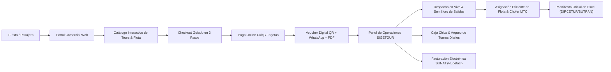

# SIGETOUR - Turismo Chilón S.A.C.
> **Sistema Integrado de Gestión de Tours, Despacho Operativo y Control de Flota**  
> *Cajamarca, Perú • Acreditado por MINCETUR & DIRCETUR (Certificado N° 4412)*  
> 🌐 **Plataforma Oficial en Producción:** [https://sigetour.onrender.com](https://sigetour.onrender.com)

[](https://dotnet.microsoft.com/)
[](https://www.postgresql.org/)
[](https://tailwindcss.com/)
[](https://sigetour.onrender.com)
[](https://cloudinary.com/)
[-brightgreen?logo=xunit)]()
[]()

---

## 📌 1. Descripción General del Proyecto
**SIGETOUR** es una plataforma web empresarial integral diseñada y desarrollada a medida para **Turismo Chilón S.A.C.** (RUC: 20601248901), empresa líder de transporte turístico con sede central en Jr. 2 de Mayo 569, Cajamarca, Perú.

La plataforma resuelve y unifica la cadena de valor turística en dos grandes frentes:



---

## 🔐 2. Accesos Oficiales y Credenciales del Sistema

### URLs del Ecosistema
| Entorno | Servicio | URL |
| :--- | :--- | :--- |
| **Producción** | Portal Web Principal | [https://sigetour.onrender.com](https://sigetour.onrender.com) |
| **Producción** | Panel de Operaciones | [https://sigetour.onrender.com/Admin/Dashboard](https://sigetour.onrender.com/Admin/Dashboard) |
| **Producción** | Inicio de Sesión | [https://sigetour.onrender.com/Account/Login](https://sigetour.onrender.com/Account/Login) |
| **Local (Dev)** | Portal Web Principal | `https://localhost:7103` (o `http://localhost:5047`) |
| **Local (Dev)** | Inicio de Sesión | `https://localhost:7103/Account/Login` |

### Credenciales de Acceso Sembradas por Defecto
El sistema cuenta con un seeder criptográfico automático (`IdentitySeeder`) que inicializa los roles y credenciales administrativas si no existen en la base de datos:

| Rol | Usuario | Correo Electrónico | Contraseña Inicial | Nivel de Privilegios |
| :--- | :--- | :--- | :--- | :--- |
| **SuperAdmin** | `superadmin` | `superadmin@sigetour.com` | `[Definida en IdentitySeeder]` | Control maestro total: gestión de usuarios, roles, auditoría y configuración global. |
| **Admin** | `admin` | `admin@sigetour.com` | `[Definida en IdentitySeeder]` | Administración de tours, despacho operativo, control de flota, caja chica y reservas. |

---

## 🏛️ 3. Módulos y Capacidades del Sistema

### 🚍 3.1. Módulo de Flota Vehicular y Conductores
* **Ficha Técnica Oficial:** Placa, modelo, año de fabricación, número de chasis (VIN), motor, combustible y capacidad de 14 a 19 pasajeros.
* **Semáforo Normativo de Vencimientos:** Monitoreo y alertas visuales de vigencia para:
  * SOAT Turístico.
  * CITV (Certificado de Inspección Técnica Vehicular).
  * TUC (Tarjeta Única de Circulación emitida por el MTC).
* **Unidad Insignia (Flagship):** Marcación con botón estelar de la unidad emblemática para representarla en el banner principal del catálogo público.
* **Galería Multimedia con Visor Lightbox:**
  * Subida múltiple con soporte **drag-and-drop**.
  * Selección de foto de portada (`IsCover`).
  * Visor en pantalla completa con soporte táctil (*swipe*), navegación con flechas del teclado (`←`, `→`), tecla `Esc`, contador dinámico y carrusel inferior de miniaturas.
* **Padrón de Choferes:** Registro de conductores profesionales con categoría de brevete (A-IIIa, A-IIIc), vigencia y unidad habitual.

### 🧭 3.2. Módulo de Despacho en Vivo y Manifiesto de Pasajeros (DIRCETUR / SUTRAN)
* **Tablero de Salidas Diarias:** Monitoreo en tiempo real de salidas filtrables por turno (Mañana / Tarde) y fecha.
* **Semáforo de Estados de Despacho:**
  * 🟡 `Pendiente de Asignación`: Pasajeros confirmados sin vehículo ni conductor asignados.
  * 🟠 `Abordando`: Unidad en base recibiendo pasajeros y verificando identidad.
  * 🟢 `En Ruta`: Vehículo en trayecto hacia el circuito turístico.
  * ⚪ `Completado`: Tour finalizado con retorno a la base operativa.
* **Asignación Justa de Capacidad:** Permite asignar unidades de 14 o 19 plazas según la demanda real del turno, reduciendo sobrecostos de combustible.
* **Exportación de Manifiesto Oficial en Excel (`.xlsx`):** Generación automática mediante ClosedXML del formato reglamentario exigido por DIRCETUR y SUTRAN, conteniendo datos de la empresa, placa, chofer, número de brevete y nómina completa de turistas con documento de identidad y asiento.

### 🏞️ 3.3. Módulo de Catálogo Turístico y Paquetes Destacados
* **Buscador & Filtros Inteligentes:** Búsqueda en vivo por destino/circuito, fecha de viaje, turno (Mañana/Tarde), presupuesto y nivel de exigencia física.
* **Paquetes Estrella en Portada:** Gestor de paquetes destacados con porcentaje de descuento, tarifa promocional y badge de oferta con fecha de expiración.
* **Ficha de Tour & Lightbox:** Itinerario detallado con paradas y tiempos estimados, lista de inclusiones/exclusiones (guía, transporte, tickets) y galería interactiva en pantalla completa.
* **Moderación de Reseñas:** Panel para revisar y aprobar testimonios de turistas antes de su publicación en el portal.

### 💳 3.4. Módulo de Checkout, Pagos Online y Vouchers de Viaje
* **Proceso de Compra en 3 Pasos:** Validación en tiempo real de datos del titular, desglose de recojo en hotel céntrico de Cajamarca y políticas de viaje.
* **Pasarela de Pagos Culqi:** Integración de tarjeta de crédito/débito con tokenización segura, validación 3DS y webhooks con verificación de firma HMAC e idempotencia.
* **Voucher Oficial de Reserva:**
  * Código único de reserva con código QR para validación rápida en el abordaje.
  * Optimizado para impresión limpia en una sola hoja A4.
  * Botón de compartir directo a WhatsApp con mensaje preconfigurado.
* **Descarga de Voucher en PDF:** Motor vectorial integrado con `QuestPDF` para generación instantánea de comprobantes descargables.
* **Notificaciones por Correo:** Envío automatizado de confirmación con voucher adjunto mediante `EmailService`.

### 💰 3.5. Módulo de Caja Chica y Arqueo Diario de Turnos
* **Fondo Fijo de Caja Chica:** Registro de egresos operativos menores (combustible, peajes, refrigerios, mantenimiento de ruta) con comprobantes digitalizados y cálculo en tiempo real del gasto pendiente de reposición (`PendingSpent`).
* **Turnos de Caja Diaria:** Apertura con saldo inicial en efectivo, captura automática de cobros por reservas web/ventanilla, arqueo físico y conciliación de diferencias.
* **Liquidación Financiera en Excel:** Exportación completa del reporte de caja diaria en formato `.xlsx`.

### 🧾 3.6. Facturación Electrónica SUNAT (Nubefact)
* Emisión automática de **Boletas de Venta Electrónicas (`BBB1`)** y **Facturas Electrónicas (`FFF1`)** bajo estándar UBL 2.1 de SUNAT.
* Validación automática de DNI ante RENIEC y RUC ante SUNAT.

### ☁️ 3.7. Almacenamiento Multimedia Permanente (Cloudinary)
* Almacenamiento desacoplado en la nube en carpetas organizadas (`sigetour/vehicles` y `sigetour/tours`).
* Optimización automática al vuelo con conversión a formatos ligeros (`.webp`, `.avif`) y compresión inteligente (`q_auto, f_auto`).
* Eliminación sincronizada: al eliminar una foto en el panel, se remueve de Cloudinary liberando espacio.
* **Fallback local transparente:** Si no hay credenciales de Cloudinary configuradas, la aplicación guarda automáticamente en el disco local sin interrumpir el funcionamiento.

---

## 🛠️ 4. Stack Tecnológico y Arquitectura

```
SIGETOUR/
├── SIGETOUR.API/                     # Proyecto Web ASP.NET Core 10 (MVC + Web API)
│   ├── Application/                  # Lógica de aplicación, DTOs, Mappings y Servicios
│   │   ├── DTOs/                     # Objetos de transferencia de datos
│   │   ├── Interfaces/               # Contratos e interfaces de servicios
│   │   ├── Invoicing/                # Servicio de facturación electrónica Nubefact
│   │   ├── Mappings/                 # Perfiles de AutoMapper
│   │   ├── Options/                  # Clases de configuración fuertemente tipadas (Cloudinary)
│   │   ├── Payments/                 # Integración Culqi (Tokens, Cargos, Webhooks HMAC)
│   │   └── Services/                 # Implementaciones (Cloudinary, PDF, Email, Excel)
│   ├── Controllers/                  # Controladores RESTful API y Controladores UI MVC
│   │   └── UI/                       # AdminController, BookingController, TourController, etc.
│   ├── Core/Entities/                # Entidades de dominio y modelo relacional
│   ├── Infrastructure/Data/          # AppDbContext, configuraciones de EF Core y Seeders
│   └── Views/                        # Vistas Razor (.cshtml) con Tailwind CSS
└── SIGETOUR.Tests/                   # Suite de pruebas automatizadas (xUnit + Moq)
    ├── Audit/                        # Auditoría de hardening y seguridad
    ├── Controllers/                  # Pruebas de controladores administrativos y públicos
    ├── Helpers/                      # Factories de DbContext InMemory y Mocks
    ├── Payments/                     # Pruebas unitarias e integración de Culqi
    └── Services/                     # Pruebas de Cloudinary, PDF, Despacho y Contacto
```

* **Lenguaje & Framework:** C# 13 / .NET 10.0 (ASP.NET Core).
* **ORM:** Entity Framework Core 10 con soporte SplitQuery y migraciones PostgreSQL.
* **Base de Datos:** PostgreSQL 16+ (soporte para Neon Lakebase Postgres y Render PostgreSQL).
* **Seguridad:** ASP.NET Core Identity con esquema Cookie persistente, protección CSRF y JWT Bearer.
* **Frontend:** Razor Views, Tailwind CSS v3 (diseño responsivo mobile-first), Material Symbols Outlined.
* **Accesibilidad:** WCAG 2.1 AA auditado por SonarQube Cloud (etiquetas semánticas `<button>`, `<label>` asociadas).
* **Reportería y Documentos:** ClosedXML (`.xlsx`) y QuestPDF (`.pdf`).
* **Pruebas:** xUnit con **171 pruebas unitarias 100% aprobadas**.

---

## ⚙️ 5. Configuración y Puesta en Marcha Local

### Prerrequisitos
* [.NET 10.0 SDK](https://dotnet.microsoft.com/download/dotnet/10.0) instalado.
* [PostgreSQL](https://www.postgresql.org/) v14 o superior (o una base de datos en Neon/Cloud).
* Git instalado.

### Pasos de Instalación
1. **Clonar el repositorio:**
   ```bash
   git clone https://github.com/N4TSUg/SIGETOUR.git
   cd SIGETOUR
   ```

2. **Configurar la base de datos:**
   En `SIGETOUR.API/appsettings.Development.json` (o en un archivo `.env` en la raíz), configura tu conexión:
   ```json
   {
     "ConnectionStrings": {
       "DefaultConnection": "Host=localhost;Port=5432;Database=sigetour_db;Username=postgres;Password=tu_password"
     }
   }
   ```

3. **Restaurar dependencias y compilar:**
   ```bash
   dotnet restore
   dotnet build
   ```

4. **Ejecutar la suite de pruebas unitarias:**
   ```bash
   dotnet test SIGETOUR.Tests/SIGETOUR.Tests.csproj
   ```
   *(Verificar que se ejecuten las 171 pruebas con 0 errores).*

5. **Iniciar la aplicación:**
   ```bash
   dotnet run --project SIGETOUR.API/SIGETOUR.API.csproj
   ```
   Abre tu navegador en `https://localhost:7103` o `http://localhost:5047`.  
   *Las tablas de la base de datos y los usuarios se sembrarán automáticamente al iniciar.*

---

## 🌐 6. Despliegue en Producción (Render)

El servicio está configurado para integración y despliegue continuo (CI/CD) automático desde la rama `main` en **Render**:

* **Entorno:** Web Service Linux (.NET 10).
* **Build Command:**
  ```bash
  cd SIGETOUR && dotnet publish SIGETOUR.API/SIGETOUR.API.csproj -c Release -o out
  ```
* **Start Command:**
  ```bash
  cd SIGETOUR/out && ./SIGETOUR.API
  ```

### Matriz Completa de Variables de Entorno (.env / Render)

A continuación se detalla la nómina completa de variables de entorno requeridas por la aplicación, organizadas por módulo funcional. Todos los valores sensibles están enmascarados con marcadores para proteger las credenciales:

| Categoría | Variable | Descripción | Valor / Formato de Ejemplo |
| :--- | :--- | :--- | :--- |
| **Servidor** | `ASPNETCORE_ENVIRONMENT` | Entorno de ejecución de ASP.NET Core | `Production` / `Development` |
| **Servidor** | `PORT` | Puerto HTTP dinámico del contenedor | `80` (o asignado por Render) |
| **Base de Datos** | `DATABASE_URL` | Cadena de conexión URI a PostgreSQL | `postgresql://<user>:<password>@<host>/<database>?sslmode=require` |
| **Seguridad** | `Jwt__Key` | Clave secreta para firma de tokens JWT | `<clave_secreta_jwt_minimo_256_bits>` |
| **Seguridad** | `Payments__CheckoutSigningKey` | Llave HMAC para firma de checkout | `<clave_secreta_checkout_base64_32bytes>` |
| **Pagos Culqi** | `Culqi__PublicKey` | Llave pública de integración Culqi | `pk_test_<tu_public_key>` |
| **Pagos Culqi** | `Culqi__SecretKey` | Llave privada secreta de Culqi | `sk_test_<tu_secret_key>` |
| **Pagos Culqi** | `Culqi__WebhookUser` | Usuario para autenticación de Webhook | `<usuario_webhook_culqi>` |
| **Pagos Culqi** | `Culqi__WebhookPassword` | Contraseña para autenticación de Webhook | `<password_webhook_culqi>` |
| **Facturación** | `Nubefact__Ruta` | Endpoint API del PSE Nubefact | `https://api.nubefact.com/api/v1/<tu_identificador>` |
| **Facturación** | `Nubefact__Token` | Token de autorización de Nubefact | `<tu_token_autorizacion_nubefact>` |
| **Facturación** | `Nubefact__Mode` | Modo de facturación SUNAT | `Demo` / `Production` |
| **Facturación** | `Nubefact__BoletaSeries` | Serie oficial para Boletas Electrónicas | `BBB1` |
| **Facturación** | `Nubefact__FacturaSeries` | Serie oficial para Facturas Electrónicas | `FFF1` |
| **Multimedia** | `Cloudinary__CloudName` | Nombre de cuenta Cloudinary | `<tu_cloud_name>` |
| **Multimedia** | `Cloudinary__ApiKey` | Clave API pública de Cloudinary | `<tu_api_key>` |
| **Multimedia** | `Cloudinary__ApiSecret` | Clave API secreta de Cloudinary | `<tu_api_secret>` |
| **Multimedia** | `CLOUDINARY_URL` *(Opcional)* | Conexión en una sola línea | `cloudinary://<api_key>:<api_secret>@<cloud_name>` |
| **Correos SMTP** | `SMTP_HOST` | Servidor SMTP para envío de vouchers | `smtp.gmail.com` |
| **Correos SMTP** | `SMTP_PORT` | Puerto de conexión SMTP TLS | `587` |
| **Correos SMTP** | `SMTP_USER` | Usuario o correo remitente SMTP | `<tu_correo_emisor@gmail.com>` |
| **Correos SMTP** | `SMTP_PASSWORD` | Contraseña de aplicación SMTP | `<tu_contraseña_aplicacion_smtp>` |
| **Correos SMTP** | `SMTP_ENABLE_SSL` | Habilitación de cifrado SSL/TLS | `true` |
| **Correos SMTP** | `SMTP_FROM_NAME` | Nombre visible del remitente | `"Turismo Chilón Cajamarca"` |
| **Correos Brevo** | `BREVO_API_KEY` | Llave API para transaccional Brevo | `<tu_api_key_de_brevo>` |
| **Empresa** | `Company__TradeName` | Nombre comercial de la agencia | `"TURISMO CHILÓN"` |
| **Empresa** | `Company__LegalName` | Razón social oficial | `"TRANSPORTE & TURISMO CAJAMARCA S.A.C."` |
| **Empresa** | `Company__Ruc` | Registro Único de Contribuyente | `20601248901` |
| **Empresa** | `Company__FiscalAddress` | Domicilio fiscal y base operativa | `"Jr. 2 de Mayo 569, Cajamarca - Perú"` |
| **Empresa** | `Company__Phone` | Central telefónica de atención | `"+51 928 876 259 / +51 944 746 364"` |
| **Empresa** | `Company__WhatsApp` | Número WhatsApp principal | `928876259` |
| **Empresa** | `Company__WhatsAppSecondary` | Número WhatsApp de soporte | `944746364` |
| **Empresa** | `Company__Email` | Correo corporativo institucional | `informes@turismochilon.com` |

---

### Plantilla de Archivo `.env` (Para Entorno Local / Desarrollo)

Puedes crear un archivo `.env` o `.env.local` en la raíz del proyecto copiando esta estructura y completando los valores entre `<...>`:

```ini
# --- ENTORNO Y HOSTING ---
ASPNETCORE_ENVIRONMENT=Production

# --- BASE DE DATOS POSTGRESQL ---
DATABASE_URL="postgresql://<db_user>:<db_password>@<db_host>/<db_name>?sslmode=require"

# --- SEGURIDAD Y TOKENS ---
Jwt__Key="<clave_secreta_jwt_min_256_bits>"
Payments__CheckoutSigningKey="<clave_firma_hmac_checkout_32bytes>"

# --- PASARELA DE PAGOS CULQI ---
Culqi__PublicKey="pk_test_<tu_public_key>"
Culqi__SecretKey="sk_test_<tu_secret_key>"
Culqi__WebhookUser="<usuario_webhook_culqi>"
Culqi__WebhookPassword="<password_webhook_culqi>"

# --- FACTURACIÓN ELECTRÓNICA SUNAT (NUBEFACT) ---
Nubefact__Ruta="https://api.nubefact.com/api/v1/<tu_identificador>"
Nubefact__Token="<tu_token_autorizacion_nubefact>"
Nubefact__Mode="Demo"
Nubefact__BoletaSeries="BBB1"
Nubefact__FacturaSeries="FFF1"

# --- ALMACENAMIENTO MULTIMEDIA (CLOUDINARY) ---
Cloudinary__CloudName="<tu_cloud_name>"
Cloudinary__ApiKey="<tu_api_key>"
Cloudinary__ApiSecret="<tu_api_secret>"

# --- NOTIFICACIONES Y CORREOS (SMTP / GMAIL / BREVO) ---
SMTP_HOST="smtp.gmail.com"
SMTP_PORT=587
SMTP_USER="<tu_correo_emisor@gmail.com>"
SMTP_PASSWORD="<tu_contraseña_aplicacion_smtp>"
SMTP_ENABLE_SSL=true
SMTP_FROM_NAME="Turismo Chilón Cajamarca"
BREVO_API_KEY="<tu_api_key_de_brevo>"

# --- IDENTIDAD INSTITUCIONAL (TURISMO CHILÓN S.A.C.) ---
Company__TradeName="TURISMO CHILÓN"
Company__LegalName="TRANSPORTE & TURISMO CAJAMARCA S.A.C."
Company__Ruc="20601248901"
Company__FiscalAddress="Jr. 2 de Mayo 569, Cajamarca - Perú"
Company__Phone="+51 928 876 259 / +51 944 746 364"
Company__WhatsApp="928876259"
Company__WhatsAppSecondary="944746364"
Company__Email="informes@turismochilon.com"
```

---

## 📸 7. Banco de Imágenes Oficiales (Recursos de Gerencia)

Carpetas oficiales facilitadas por la **Gerencia de Turismo Chilón S.A.C.** para la alimentación fotográfica del catálogo:

1. 🌲 **Granja Porcón:** [Ver fotos en Google Drive](https://drive.google.com/drive/folders/1TuNSSZLvPQlfJ7igR9T0TO_moiK2Vent)
2. 🎸 **Namora (Guitarras y Laguna San Nicolás):** [Ver fotos en Google Drive](https://drive.google.com/drive/folders/1htID0HCeG4kGQoMv1KxF-8qyeTplrWOQ)
3. 🏰 **Castillo de Chancay / Alrededores:** [Ver fotos en Google Drive](https://drive.google.com/drive/folders/1LQ2gorrwzbYdFOGAE00Ots9aQ7gBBECQ)
4. ♨️ **Yumagual (Aguas Termomedicinales):** [Ver fotos en Google Drive](https://drive.google.com/drive/folders/1hUdgCg6Xr_2sl1ULMB8cY_LESFa5BWGv)
5. 👑 **Baños del Inca (Complejo Termal Histórico):** [Ver fotos en Google Drive](https://drive.google.com/drive/folders/15e4IdtH_wQdJtxMyC92zoUvXd4qx_DGS)
6. 🏔️ **Lagunas de Alto Perú:** [Ver fotos en Google Drive](https://drive.google.com/drive/folders/13vp35CtrAfWhom2fVmaQnBI_PfyP3_rC)
7. ⛪ **Polloc (Santuario Virgen del Rosario):** [Ver fotos en Google Drive](https://drive.google.com/drive/folders/1rgW1OBWHTJzp5EvkdUiXk5SAYCmf01_e)

---

## 📋 8. Resumen de Circuitos Comerciales Oficiales

| N° | Circuito / Tour | Subtítulo / Badge | Horario / Turno | Tarifa Sugerida | Atractivos Principales |
| :-: | :--- | :--- | :--- | :-: | :--- |
| **1** | **Ventanillas de Otuzco** | Cementerio pre-inca | 3:30 PM – 6:30 PM | S/ 35.00 | Ventanillas pre-incas, Jardín de Hortensias, Artesanía, Fundo Tres Molinos. |
| **2** | **Collpa y Llacanora** | Llamado de vacas | 3:30 PM – 7:00 PM | S/ 35.00 | Ex-hacienda La Collpa, laguna artificial, establo, degustación de lácteos, cascadas. |
| **3** | **Castillo de Yanamarca** | Estilo medieval | Mañana / Tarde | S/ 40.00 | Castillo medieval, esculturas en piedra/madera, vistas panorámicas. |
| **4** | **City Tour Peatonal** | Tradición e historia | 10:00 AM / 3:30 PM | S/ 25.00 | Plaza de Armas, Cuarto del Rescate, Catedral, San Francisco, Belén, Santa Apolonia. |
| **5** | **Namora y San Nicolás** | Guitarras y totora | 9:30 AM – 3:00 PM | S/ 45.00 | Talleres de guitarras en Namora, Laguna San Nicolás, botes de totora, gastronomía. |
| **6** | **Cumbe Mayo** | 3ra. Maravilla del Perú | 9:30 AM – 2:00 PM | S/ 40.00 | Mirador Bellavista, Frailones, piedra de sacrificios, acueducto milenario (3,000 años). |
| **7** | **Granja de Porcón** | La Suiza peruana | 9:30 AM – 2:00 PM | S/ 40.00 | Huambocancha, bosque de pinos, zoológico andino (otorongos, pumas, osos), textilería. |

---

## 📄 9. Licencia y Derechos de Autor
Desarrollado para **Turismo Chilón S.A.C.** como parte del Proyecto de Tesis / Capstone de Ingeniería de Software.  
Todos los derechos reservados © 2025-2026.
